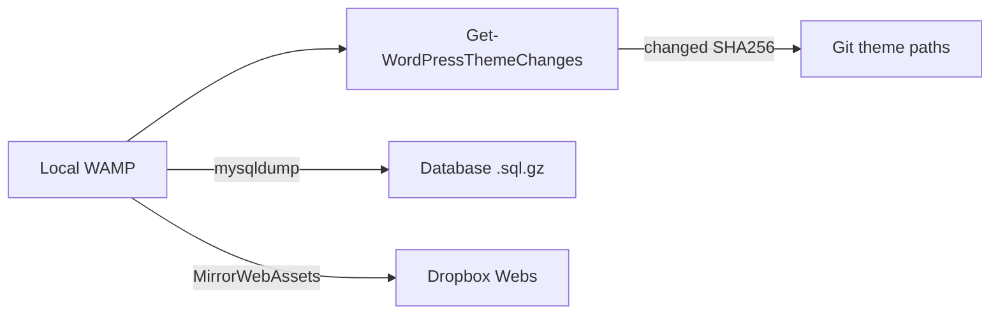

<!--
IndexTitle: WordPressSave Workflow Index
IndexDescription: Commands for Save-LocalWordPress.ps1, manifest, and database export.
IndexType: Capability
CapabilityName: WordPressSave
CapabilityVersion: 1
IndexStatus: Active
LastEdited: 2026-09-03
-->

# WordPressSave Workflow Index

## One Command

```powershell
.\Automation\WordPressSave\Save-LocalWordPress.ps1
```

Preview:

```powershell
.\Automation\WordPressSave\Save-LocalWordPress.ps1 -WhatIf
```

Partial:

```powershell
.\Automation\WordPressSave\Save-LocalWordPress.ps1 -ThemeOnly
.\Automation\WordPressSave\Save-LocalWordPress.ps1 -DatabaseOnly
.\Automation\WordPressSave\Save-LocalWordPress.ps1 -DropboxOnly
```

Scan changed theme files only:

```powershell
.\Automation\WordPressSave\Get-WordPressThemeChanges.ps1
```

## Manifest

[`Automation/WordPressSave/ThemeTrackManifest.json`](../../Automation/WordPressSave/ThemeTrackManifest.json)

Set `siteKey`, WAMP paths, and repo targets before first save.

## Flow



## Inverse (restore)

| Need | Command / path |
| --- | --- |
| DB from Git | Import `Content/Website/Database/*.sql.gz` |
| Theme/uploads from Dropbox | `Restore-WebAssetsFromDropbox.ps1 -SiteKey <siteKey>` |
| Git → WAMP content | `ges-build.php --write` (owner-approved) |

## Related

- [Rules.md](Rules.md)
- [Plans/WordPressSaveWorkflow.md](../../Plans/WordPressSaveWorkflow.md)
